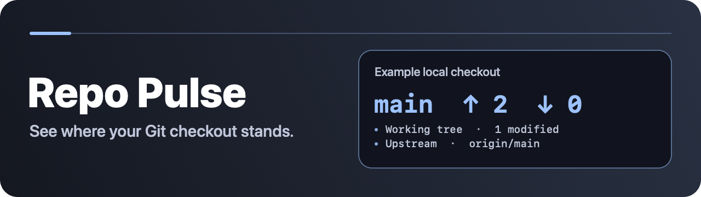

<p align="center">
  
</p>

# Repo Pulse

A read-only snapshot of a local Git checkout. See the branch, working-tree changes, recent commit subjects, and ahead/behind counts against the local copy of the upstream ref.

## At a glance

| Task | How |
| --- | --- |
| **Check the working tree** | See the current branch and local changes. |
| **Compare with upstream** | Read ahead and behind counts from the upstream ref already on disk. |
| **Review history or export** | Use `--commits` to set the history length and `--json` for structured output. |

## Quick start

```sh
python3 repo_pulse.py /path/to/repo
python3 repo_pulse.py . --commits 10 --json
```

Requires Python 3.8+ and Git. Run from a project or pass any folder inside it. Repo Pulse reads local Git data without fetching, staging, or committing. Ahead and behind counts reflect the upstream ref already present in your checkout. A fresh repository with no commits still reports its working-tree changes.

[MIT license](LICENSE)
